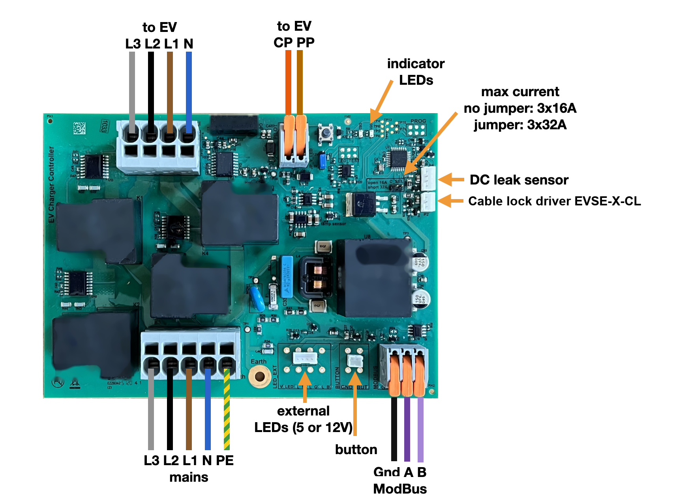

English · Dutch version to follow

# EdgeTech charge controller EVSE-C-3x32A

Everything you need to build with the EdgeTech charge controller: how to install it, how to talk to it over Modbus, and examples of what you can make with it.

The EVSE-C-3x32A is a Mode 3 AC charge controller for one charge point, up to 3 × 32 A. It talks to the car over the control pilot, switches the power, measures current and voltage per phase, protects against DC leakage with the EVSE-X-DCD sensor, and is a Modbus RTU slave on RS485. Anything that speaks Modbus can control it: our site controllers, evcc on a Raspberry Pi, or your own microcontroller.

## Quick start

1. **Install** the charge controller: [docs/en/installation.md](docs/en/installation.md).
2. **Connect Modbus**: GND, A and B with 3 × 0.75 mm² stranded cable. 9600 baud, 8N1. The charger leaves the factory at address 1, where it only answers after a state change (press the button on the board). An EdgeTech site controller moves each new charger to its own address; with your own controller, set an address of 2 or higher (register 0x0200).
3. **Set the current**: write the limit in amps to register 0x0201 and read the state from 0x0103. All registers: [docs/en/modbus-registers.md](docs/en/modbus-registers.md).

## Information

| Document | What it covers |
|---|---|
| [Installation](docs/en/installation.md) | Connections, wire colours, jumpers, LEDs, assembly steps, error codes |
| [Modbus register map](docs/en/modbus-registers.md) | Every register, state and error code, and a minimal control loop |
| [Load balancing](docs/en/load-balancing.md) | Three ways: your own controller, evcc, or an EdgeTech site controller |
| [EV wake-up](docs/en/ev-wake-up.md) | Waking cars that fall asleep during a charging pause (CP disconnect) |
| [Build your own charge point](docs/en/diy-chargepoint.md) | The DIY kit, step by step ([Nederlands](docs/nl/diy-chargepoint.md)) |

## Inspiration

[examples/](examples/) has working sketches for development boards you can buy:

| Example | What it does |
|---|---|
| [Charger control, basic](examples/charger-control-basic/) | Read the charger and set the current |
| [Touch-display control](examples/touch-display-control/) | Control the charger from a touch screen |
| [Smart meter reader](examples/smart-meter-reader/) | Read the P1 port of a DSMR 5 smart meter |
| [Smart-meter load balancing](examples/smart-meter-load-balancing/) | Limit the charge current to what the house can spare |
| [Electricity-price schedule](examples/electricity-price-schedule/) | Fetch day-ahead prices to charge when power is cheap |

[tools/modbus-tool](tools/modbus-tool/) is a Python tool to test the charge controller from a PC.

## Hardware

- [hardware/fit](hardware/fit/): STEP models and drawings to fit the electronics in your enclosure.
- [hardware/brackets](hardware/brackets/): 3D-printable mounting brackets.

## Firmware

The firmware flasher is attached to the [releases](../../releases) of this repository. It updates the charge controller over Modbus.

## Languages

English is the main language: every document is in English in [docs/en](docs/en/). Dutch translations go in [docs/nl](docs/nl/) with the same file names. Code, comments and file names are always English.

## Safety

The examples only talk Modbus at low voltage. Work on the mains supply and in the metering cabinet is for a qualified electrician.

## Contact

[support@edgetech.eu](mailto:support@edgetech.eu) · [edgetech.eu](https://edgetech.eu)
