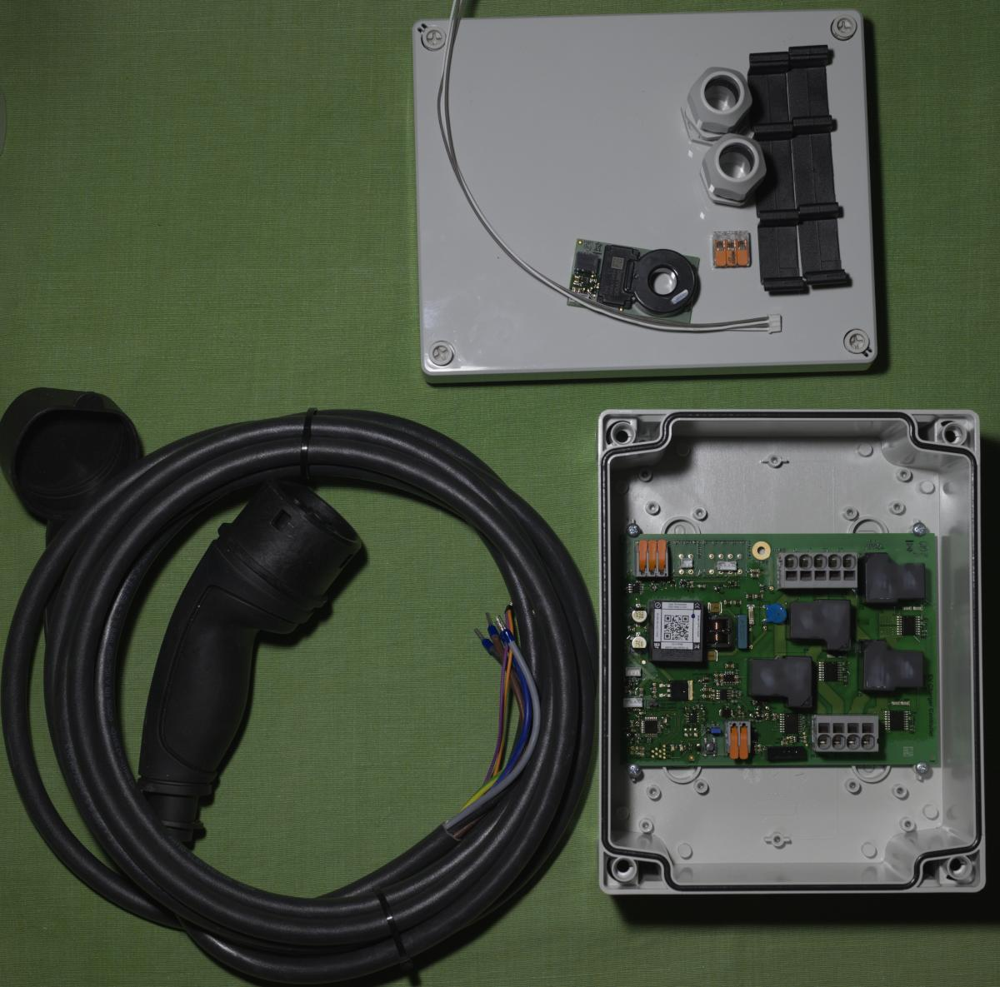

English · [Nederlands](../nl/diy-chargepoint.md)

# Build your own charge point

We have done the preparation; this page takes you through putting it together.

> [!IMPORTANT]
> This guide is for experienced hobbyists: people who know how to connect a device safely to a 3-phase supply, what a residual-current device (RCD) is, and how large loads are connected in the meter cupboard. We always recommend that work in the meter cupboard is done by a qualified electrician.

## 1. The basic charge point

Without load balancing: the charge point does not know what else the house is using. If the house uses a lot at the same time, the main fuse can trip. So only charge when there is enough capacity, typically between 22:00 and 04:00, and take heat pumps, home batteries and electric boilers into account.

The basic kit:

- charge controller EVSE-C-3x32A
- DC-leakage sensor EVSE-X-DCD with its lead
- charging cable
- enclosure and cable glands
- mounting brackets ([3D-printable versions](../../hardware/brackets/))
- push-in connector for the earth wires

Follow [Installing the charge controller](installation.md) for the connections, the assembly steps, the LEDs and the error codes.

## 2. Add load balancing

Load balancing limits the charge current to what the house can spare. Choose one of three ways, all described in [Load balancing](load-balancing.md):

- **A. Your own controller** on a development board, for example on the P1 port of the smart meter. See the [examples](../../examples/).
- **B. A Raspberry Pi with evcc**, the open-source charge manager.
- **C. An EdgeTech site controller**: the EVSE-SC-02 on the P1 port of a DSMR 5 smart meter, or the EVSE-SC-01 with CT clamps for other houses. With the MyCharger app.

Lay a Modbus cable (3 × 0.75 mm² stranded) next to the power cable from the start, also when you begin without load balancing.

## 3. Wake-up for sleeping cars

Some cars fall asleep during a long charging pause and don't start again by themselves. The charge controller can wake them: see [EV wake-up](ev-wake-up.md).
