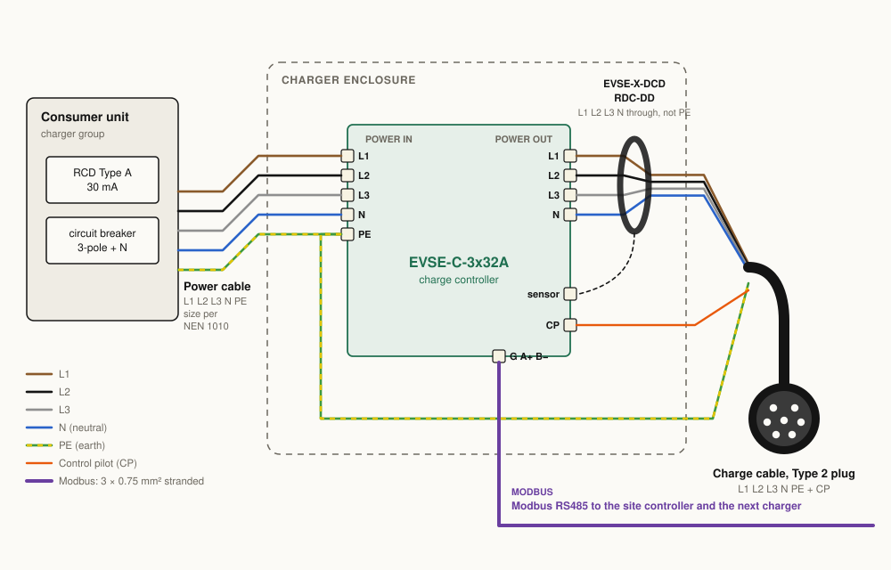
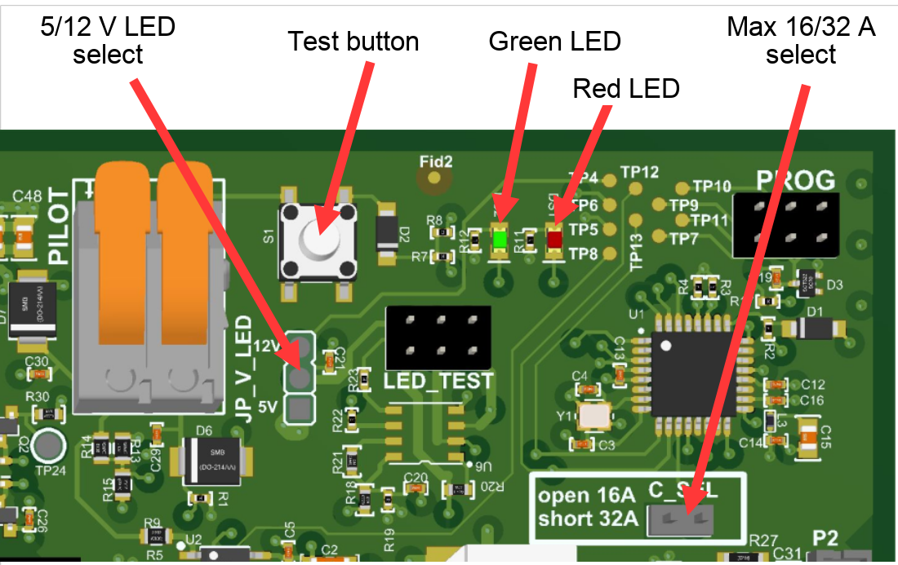
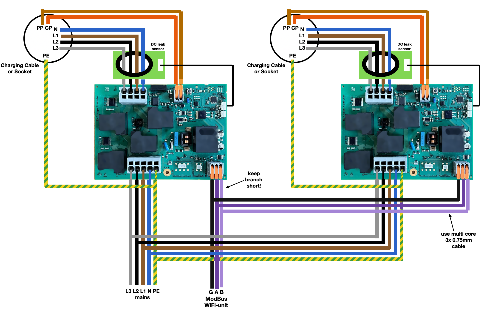

English · Dutch version to follow

# Installing the charge controller EVSE-C-3x32A

> [!IMPORTANT]
> This guide is for experienced hobbyists and installers: people who know how to connect a device safely to a 3-phase supply, what a residual-current device (RCD) is, and how large loads are connected in the metering cabinet. We always recommend that work in the metering cabinet is done by a qualified electrician.

## Connections

| Connection | Where | What |
|---|---|---|
| Mains in | Grey 5-pole terminal | L1, L2, L3, N, PE. Wire colours: L1 brown, L2 black, L3 grey, N blue, PE green-yellow |
| To the car | Grey 4-pole terminal | L1, L2, L3, N of the charging cable or socket. PE of the cable goes to the PE of the mains, not through this terminal |
| Control pilot | 2-pole terminal with orange levers | CP: the thin signal wire of the charging cable or socket. PP: only with a Type 2 socket; with a fixed cable PP stays empty |
| Modbus | 3-pole terminal with orange levers | GND, A, B. Use 3 × 0.75 mm² stranded multi-core cable and keep branches short |
| RDC-DD | Upper white connector on the right | The RDC-DD EVSE-X-DCD, supplied with every charge controller |
| Cable lock | Lower white connector on the right | The cable lock driver EVSE-X-CL, for chargers with a Type 2 socket |
| External LED | LED EXT, 4-pin | Common-cathode RGB LED or 3 separate LEDs, 5 V or 12 V (see below) |
| Button | BUTTON, 2-pin | External push button (GND, BUT) |

The RDC-DD: lead L1, L2, L3 and N through the ring. Do **not** lead PE through it.

The schematic version of the same wiring:

## Jumpers, LEDs and test button

| Item | Setting |
|---|---|
| C_SEL (max current) | Open: 3 × 16 A. Jumper fitted: 3 × 32 A |
| JP_V_LED | Voltage for the external LED: 5 V or 12 V |
| Test button | Gives the board a state change. At the factory address 1 the board only answers after a state change |
| Green LED | Flashes every 3 seconds when the board is powered and OK |
| Red LED | Error code, see [Status and error codes](#status-and-error-codes) |

### External LED

- **LED EXT** (4-pin, 2.0 mm pitch): VLED, R, G, B. Connect a common-cathode RGB LED, or 3 separate LEDs.
- **JP_V_LED** (3-pin header with jumper) selects VLED: 5 V or 12 V.
- **LED TEST** (2 × 3 header, 0.1" pitch, solder): the same signals as LED EXT, plus a digital output for addressable LEDs. Pin 1 VLED, pin 2 R, pin 3 Dout, pin 4 G, pin 5 GND, pin 6 B. Use an external supply for more than one addressable LED.

## Assembly steps

1. **Choose the place for the charge point.** Always lay a Modbus cable (3 × 0.75 mm² stranded) next to the power cable, also when you start without load balancing.
2. **Prepare the enclosure.** Drill the holes for the cable glands of the power cable and the charging cable with a step drill. Drill the holes in the back wall for mounting on a wall or pole, and seal the screw holes, for example with a rubber ring.
3. **Mount the charge controller** in the enclosure, directly or with the [brackets](../../hardware/brackets/).
4. **Connect the RDC-DD** to the charge controller with the supplied lead.
5. **Earth.** Connect the supplied green-yellow wire to PE on the 5-pole terminal, and the other end to the supplied push-in connector. All earth wires meet in that connector.
6. **Charging cable.** Feed it through its gland.
   - Put L1, L2, L3 and N through the RDC-DD ring and into the 4-pole terminal. Watch the colours. To open a terminal, push a flat screwdriver into the rectangular hole next to it.
   - Connect PE of the charging cable to the push-in earth connector.
   - Put the thin signal wire (CP) into the **CP** input of the 2-pole terminal with the orange levers, as shown in the picture. With a fixed cable, leave **PP** empty: PP is only used with a Type 2 socket, where the charger reads the cable rating from it. Lift the lever fully, push the wire in deep, close the lever and pull gently to check.
7. **Power cable.** Mount the enclosure on the wall or pole and feed the power cable through its gland.
   - Connect L1, L2, L3 and N to the 5-pole terminal. Watch the colours.
   - Connect PE to the push-in earth connector.
   - Check that no strands stick out of the terminals. Loose strands of a stranded wire can touch the next terminal and cause a short circuit.
8. **Modbus** (optional now, needed for load balancing): GND, A and B to the 3-pole terminal.
9. **Switch on** the RCD and the circuit breaker in the metering cabinet. The green LED flashes every 3 seconds.

> [!IMPORTANT]
> If the red LED flashes, check that the earth is connected properly, both to the charge controller and to the earth of the house.

### Two or more chargers

Chargers share one Modbus line. Every charger leaves the factory at address 1; give each one its own Modbus address (an EdgeTech site controller does this for you), keep the branches from the line to each board short, and use one 3 × 0.75 mm² cable for GND, A and B.

## Test by charging a car

Plug the charging cable into the car. If the car charges, you're done. If it doesn't, look at the red LED on the charge controller: its flash pattern tells you the fault.

## Status and error codes

| Condition (error byte) | Red LED |
|---|---|
| Start-up error (00000001) | Very long off, very short on |
| High temperature (10010000) | Short on, short off, short on, long off |
| Temperature too high, charging stopped (10011000) | Short on, short off, 2× short on, long off |
| No earth connected (10011100) | Short on, short off, 3× short on, briefly off |
| Relay stays switched on (10011110) | Short on, short off, 4× short on, short off |
| DC earth fault (10010110) | Short on, short off, short on, short off, 2× short on, short off |
| OK | Off |

The same errors can be read over Modbus: see the error bits in the [register map](modbus-registers.md).

## Next

- [Load balancing](load-balancing.md): limit the charge current to what the house can spare.
- [EV wake-up](ev-wake-up.md): for cars that fall asleep during a charging pause.
