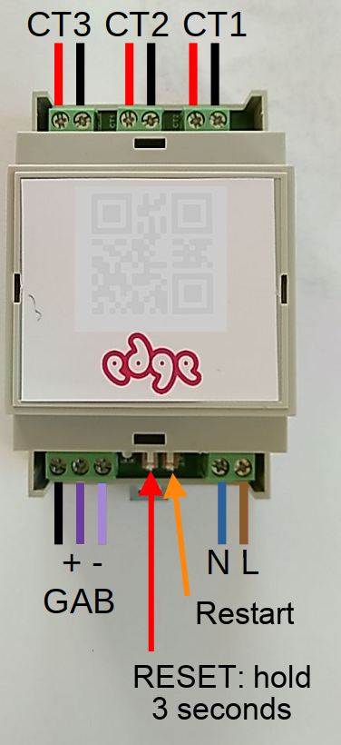
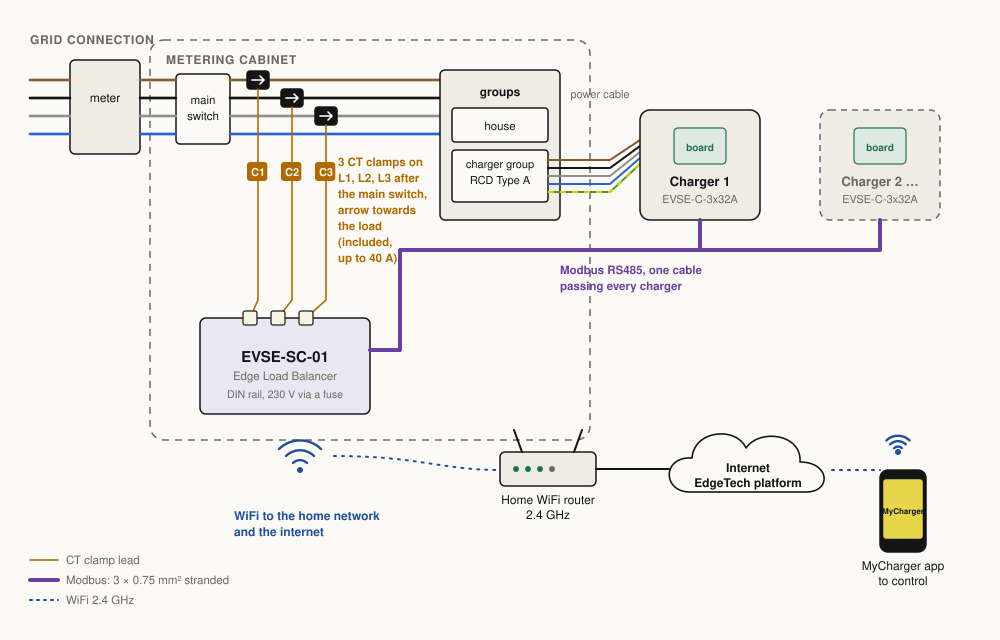
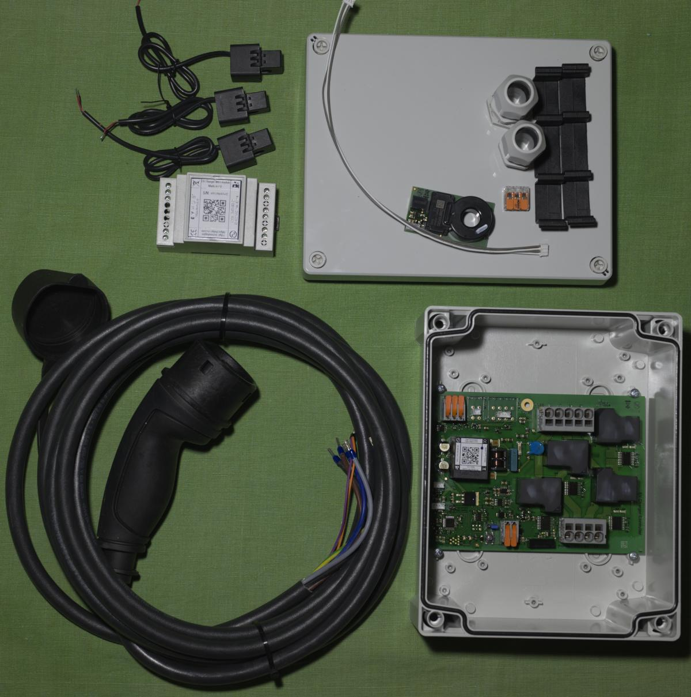
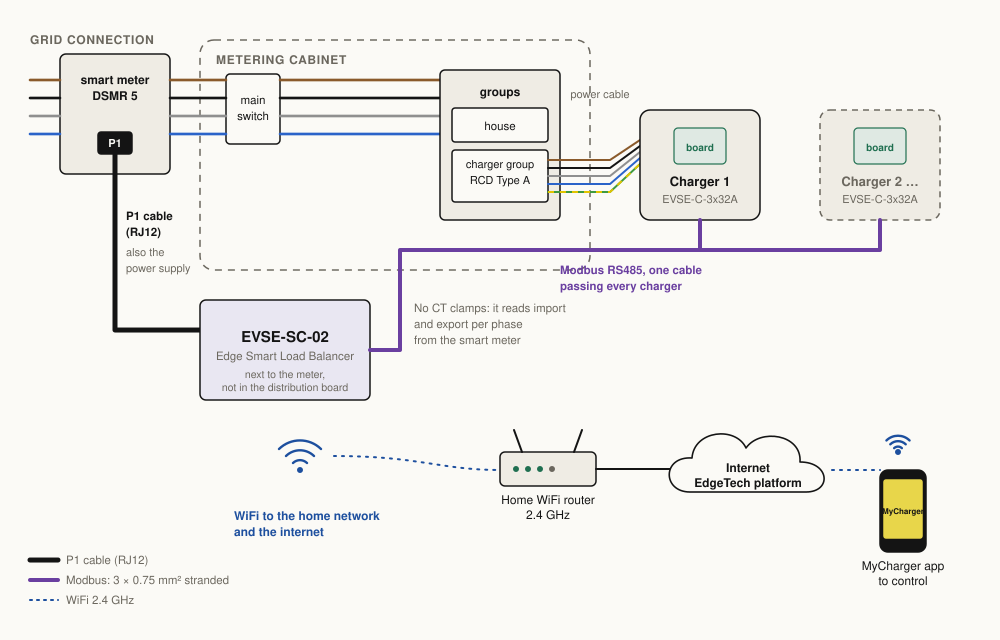
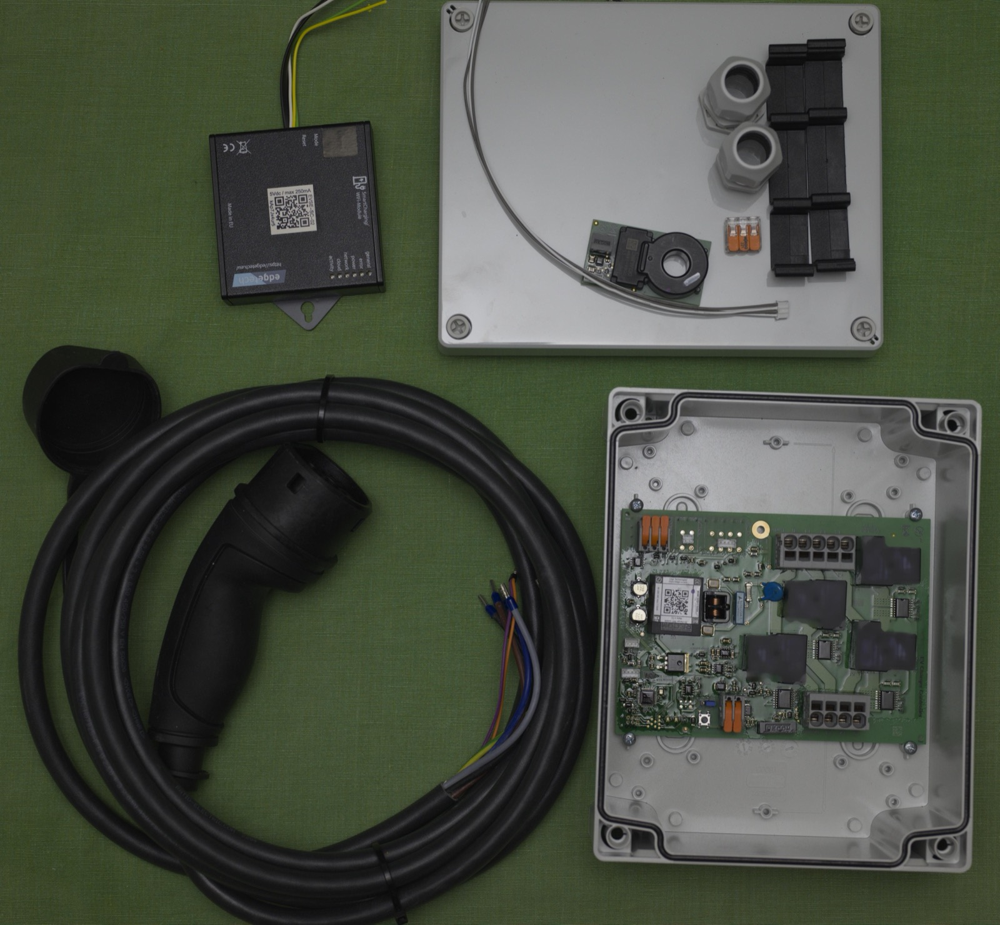

English · Dutch version to follow

# Load balancing

Load balancing protects your connection from overload. If the house draws more than the main fuse allows for too long, the fuse blows or trips; an old-style main fuse has to be replaced by the network operator, which costs money and time. You may also want to charge when energy is cheap or when the grid is quiet. Load balancing means that something measures the house and tells the charge controller, over Modbus, how much current it may use.

There are three ways to do it:

| | Who it is for | What measures the house | What controls the charger |
|---|---|---|---|
| [A. Your own controller](#a-your-own-controller) | People who program microcontrollers | Your controller, e.g. on the P1 port of the smart meter | Your code, over Modbus |
| [B. Raspberry Pi with evcc](#b-raspberry-pi-with-evcc) | People at home on a Linux command line | The smart meter, through a P1 cable | evcc, over Modbus |
| [C. EdgeTech site controller](#c-edgetech-site-controller) | Anyone who wants it ready-made | CT clamps (EVSE-SC-01) or the P1 port (EVSE-SC-02) | The site controller, with the MyCharger app |

All three talk to the charge controller over the same Modbus line: 3 × 0.75 mm² stranded cable to GND, A and B. See [installation](installation.md#connections) and the [register map](modbus-registers.md). For your own code, the two registers that matter are the current limit (0x0201) and the state (0x0103).

## A. Your own controller

For people with programming experience on a microcontroller platform. Choose a development board that has, or can be extended with, an RS485 interface. The [examples](../../examples/) show working sketches for several boards, from simply reading the charger to full load balancing on the smart meter:

- [Charger control, basic](../../examples/charger-control-basic/): read the charger and set the current.
- [Smart meter reader](../../examples/smart-meter-reader/): read the P1 port of a Dutch (DSMR 5) smart meter.
- [Smart-meter load balancing](../../examples/smart-meter-load-balancing/): both together, with a display.

## B. Raspberry Pi with evcc

For people who have used a Linux system and a terminal before. A Raspberry Pi (for example a 3B) with a P1 cable to the smart meter and an RS485 interface board runs [evcc](https://evcc.io), an open-source charge manager.

1. Write the SD card with the Raspberry Pi Imager. Choose a host name you can find back (for example `loadbalancer`). On a Pi without Ethernet, also enter the WiFi details so you can always reach the Pi with ssh.
2. Connect the Pi to your network and log in with ssh.
3. Install evcc: follow <https://docs.evcc.io/en/docs/installation>.
4. Set the charge controller to Modbus address 2 or higher first (register 0x0200); at address 1 it only answers after a state change.
5. Add the charger to `evcc.yaml`. The example below is for an RS485 board on the Pi's serial port, address 2, 9600 baud 8N1:

```yaml
chargers:
- type: template
  template: smartevse
  id: 2
  device: /dev/ttyS0
  baudrate: 9600
  comset: 8N1
  modbus: rs485serial
  name: charging point 1
```

6. With a P1 cable, make the smart meter available on a network socket with `ser2net`, and add it as the grid meter:

```yaml
# evcc.yaml
meters:
- type: template
  template: dsmr
  usage: grid
  host: 127.0.0.1   # ser2net
  port: 2000
  name: grid
```

```yaml
# ser2net.yaml
%YAML 1.1
---
connection: &conDSMR
    accepter: tcp,2000
    enable: on
    options:
      max-connections: 3
      kickolduser: true
    connector: serialdev,
              /dev/ttyUSB0,
              115200n81,local
```

7. Add load management: follow <https://docs.evcc.io/en/docs/features/loadmanagement>.

## C. EdgeTech site controller

For people who want to install everything themselves but not program the control. The site controller sits on the Modbus line, measures the house, limits the charge current, and connects to your home WiFi so you can control charging with the MyCharger app. Load balancing also keeps working without a MyCharger subscription; you then lose the control from the app.

### EVSE-SC-01 with CT clamps

For houses without a DSMR 5 smart meter. The SC-01 goes on a DIN rail in the metering cabinet. Put its three CT clamps around L1, L2 and L3 between the meter and the main switch, where the three phases are not yet split into groups.







### EVSE-SC-02 on the P1 port

For houses with a DSMR 5 smart meter. The SC-02 connects to the P1 port with an RJ12 cable and takes its power from it, so nothing goes in the metering cabinet and no clamps are needed. On the Modbus line it runs at 19200 baud.




