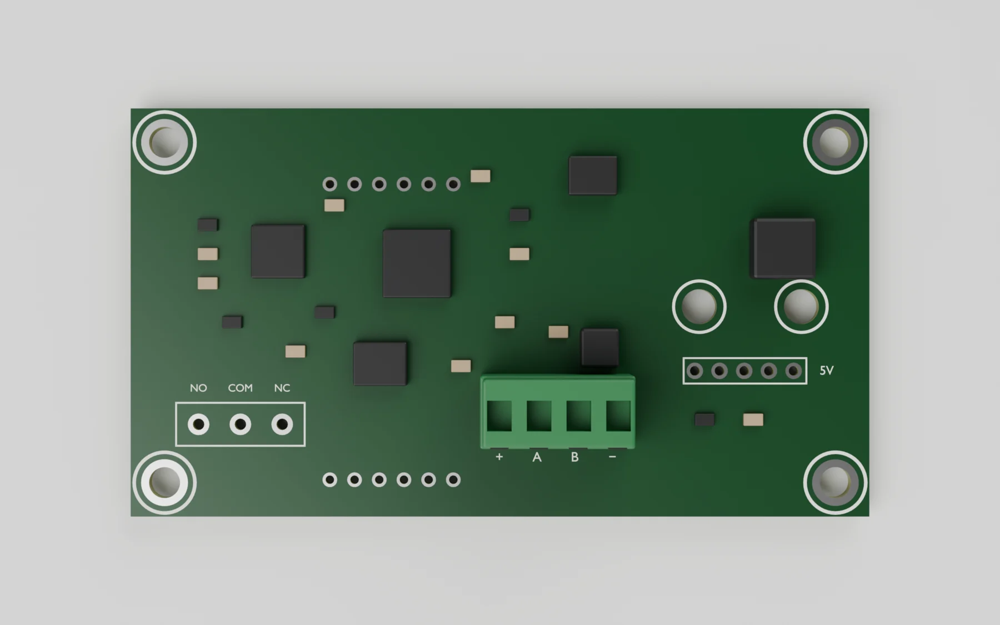
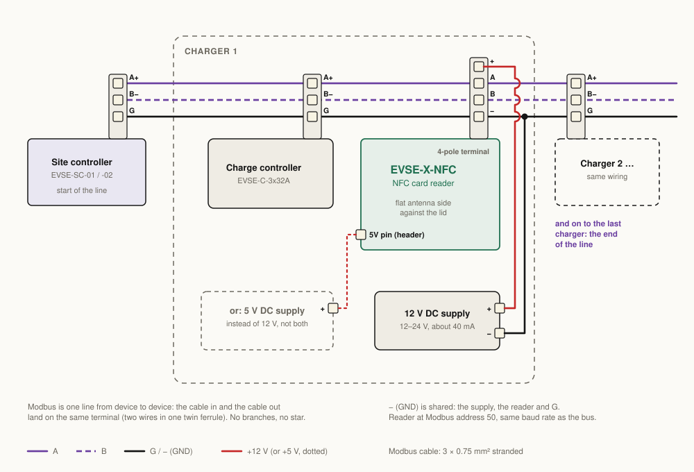

English · [Nederlands](../nl/nfc-reader.md)

# NFC card reader EVSE-X-NFC

The EVSE-X-NFC is an optional card reader for the charger. It sits inside the charger box with its flat antenna side against the plastic lid and reads cards through the lid. It is a Modbus RTU slave on the same RS485 line as the charge controller. The master (an EdgeTech site controller, or your own controller) asks it about once a second whether a card was read and gets the card ID back.

The board is the Modbus MIFARE reader of Inveo (Poland), "RFID IND Modbus Mif", as a bare board, set up by us for the charger. The maker's manual and configuration program are on [inveo.com.pl](https://inveo.com.pl/software).

## Specifications

| | |
|---|---|
| Cards | MIFARE cards, ISO/IEC 14443-A (NFC-A), 13.56 MHz; identified by the UID (4, 7 or 10 bytes). Dutch charge cards (laadpassen) are such cards |
| Reading distance | Up to about 10 cm in free air, depending on the card; less through the lid |
| Supply | 12 V DC on + and − of the 4-pole terminal (12–24 V, about 40 mA at 12 V), **or** 5 V DC on the 5V header pin. Not both |
| Modbus | RTU on RS485, A and B on the 4-pole terminal, GND on −. EdgeTech readers are set to address 50 |
| Board | 76 × 42 mm, 12 mm high, 4 × Ø3.2 mm corner holes. Leave 25 mm free in front of the terminal for the wires |
| Configuration | USB, with the maker's configuration program (a small plug-in USB board on the 5-pin header) |

## Wiring

| Reader | Goes to |
|---|---|
| + | +12 V DC of a supply in the charger box |
| A | A (A+) of the Modbus line, as on the charge controller |
| B | B (B−) of the Modbus line |
| − | GND: the − of the supply and G of the Modbus line |
| 5V pin (header) | Only when you power the reader from 5 V DC instead of 12 V. Then leave + unconnected |

Use the same 3 × 0.75 mm² stranded cable as for the rest of the Modbus line, plus one wire for the supply.

## Configuration

Only needed if you change the Modbus address or the baud rate.

1. Download the "RFID M1/U1 Configurator" from [inveo.com.pl/software](https://inveo.com.pl/software).
2. Fit the USB board on the 5-pin header and connect it to the PC. The reader is then powered from USB.
3. Set **Device Address** (we use 50), **BaudRate** (the same as the bus: 9600 with your own controller, 19200 with an EVSE-SC-02) and **Mode** (parity: None).
4. Save, then restart the reader (power off and on).
5. Close the configuration program: while it is connected, Modbus does not work.

## Reading a card

Every second:

1. Read holding register **999** (IsNewTag). 1 means a new card was read.
2. If it is 1: read register **1000** (UID length in bytes) and **1001** onwards (the UID, one byte per register). Steps 1 and 2 fit in one request: 12 registers from 999.
3. Clear the flag: write 0 to coil **1015**. Only then does the reader read the next card.

Working examples:

- [examples/nfc-reader/Raspberry_Pico2W_2CH_RS485](../../examples/nfc-reader/Raspberry_Pico2W_2CH_RS485/): Arduino sketch for a Raspberry Pi Pico 2 W with the Waveshare 2-channel RS485 module.
- [examples/nfc-reader/python](../../examples/nfc-reader/python/): Python 3 with pymodbus, for a PC or a Raspberry Pi with a USB-RS485 adapter.

## Register map

**Numbering.** The maker's manual numbers registers and coils from 1. On the wire (and in most Modbus libraries) they are 0-based, so subtract 1: the manual's holding register 1000 is address 999, coil 1016 is address 1015. The tables give both. Our site-controller firmware uses the 0-based addresses.

Supported functions: 0x01 read coils, 0x03 read holding registers, 0x05 write single coil, 0x06 write single register, 0x0F write multiple coils, 0x10 write multiple registers.

### Holding registers

| Address (0-based) | Manual | R/W | Meaning |
|---|---|---|---|
| 999 | 1000 | R/W | IsNewTag: 1 = a card was read, 0 = none. Clear it (0) before the next card is read. Same as coil 1015 |
| 1000 | 1001 | R | UID length in bytes: 4, 7 or 10 |
| 1001–1010 | 1002–1011 | R | UID, one byte per register |
| 1011 | 1012 | R | Card type |
| 1016 | 1017 | R | Model ID |
| 1017 | 1018 | R | Software version |
| 1018 | 1019 | R | Hardware version |
| 1019 | 1020 | R/W | Relay output 1 mode: 1 bistable, 2 astable, 3 timed |
| 1020 | 1021 | R/W | Output 1 time on, in 0.1 s (1–65535) |
| 1021 | 1022 | R/W | Output 1 time off, in 0.1 s |
| 1022–1024 | 1023–1025 | R/W | Output 2: mode, time on, time off |
| 1999 | 2000 | R/W | WriteEnable: write to the next card |
| 2000 | 2001 | R/W | ReadEnable: read data from the next card |
| 2001 | 2002 | R/W | Card type for data access: MIFARE 1k (0) or 4k (1) |
| 2002 | 2003 | R/W | Memory mode: linear (0) or full (1) |
| 2003 | 2004 | R/W | Data mode (0–2): how bytes are packed in the buffers |
| 2004 | 2005 | R/W | Signalling for every card read (LEDs, buzzer accept/reject) |
| 2005 | 2006 | R/W | Signalling after a data read (ok / error) |
| 2006 | 2007 | R/W | Signalling after a data write (ok / error) |
| 2007 | 2008 | R/W | HaltTag: 1 = stop with this card and wait for the next |
| 2008 | 2009 | R/W | WakeAll: 1 = switch the antenna off briefly so all cards reset |
| 2009 | 2010 | R/W | Result of the last data read: 0 ok, 1 error |
| 2010 | 2011 | R/W | Result of the last data write: 0 ok, 1 error |
| 2019–2034 | 2020–2035 | R/W | Blocks to read, one bit per block |
| 2039–2054 | 2040–2055 | R/W | Blocks to write, one bit per block |
| 2099–2354 | 2100–2355 | R/W | Read authorisation per block: key A or B, stored key 0–7 |
| 2399–2654 | 2400–2655 | R/W | Write authorisation per block |
| 2699–2954 | 2700–2955 | R/W | Read result per block (0 = ok) |
| 2999–3254 | 3000–3255 | R/W | Write result per block (0 = ok) |
| 3999–8094 | 4000–8095 | R/W | Read buffer (card data) |
| 9999–14094 | 10000–14095 | R/W | Write buffer (card data) |

### Coils

| Address (0-based) | Manual | R/W | Meaning |
|---|---|---|---|
| 999 | 1000 | R/W | Relay output 1 on/off |
| 1000 | 1001 | R/W | Relay output 2 on/off |
| 1001 | 1002 | R | Relay 1 coil state |
| 1002 | 1003 | R | Relay 2 coil state |
| 1009 | 1010 | R | Input 1 |
| 1010 | 1011 | R | Input 2 |
| 1011 | 1012 | R/W | LED 1 (red) |
| 1012 | 1013 | R/W | LED 2 (green) |
| 1013 | 1014 | W | Buzzer: accept sound |
| 1014 | 1015 | W | Buzzer: reject sound |
| 1015 | 1016 | R/W | IsNewTag (same as holding register 999). Write 0 to read the next card |
| 1016 | 1017 | R/W | ResetFlag: 1 after power-on; you can clear it to detect a restart |

Relays and inputs: the relay terminal (NC, COM, NO) is not fitted on the EdgeTech version, so the relay and input registers have no effect there.

Settings written over Modbus (outputs, signalling) are not stored: after a restart the reader goes back to what the configuration program saved.

## Notes

- **Continuous read mode** (in the configuration program): if it is on, the reader does not set IsNewTag. Leave it off when you poll as above.
- **Whitelist.** The reader only reports the card ID. Deciding who may charge is done by the master: an EdgeTech site controller (whitelist in the MyCharger app) or your own code.
- **EdgeTech site-controller firmware** reads up to 7 UID bytes. Cards with a 4- or 7-byte UID (almost all) are fine.

## Licence

This document: [CC BY 4.0](../../LICENSE-docs.md). Example code: [MIT](../../LICENSE). Register data from the maker's manual "RFID IND Modbus Mif" (software 1.40 and later).
