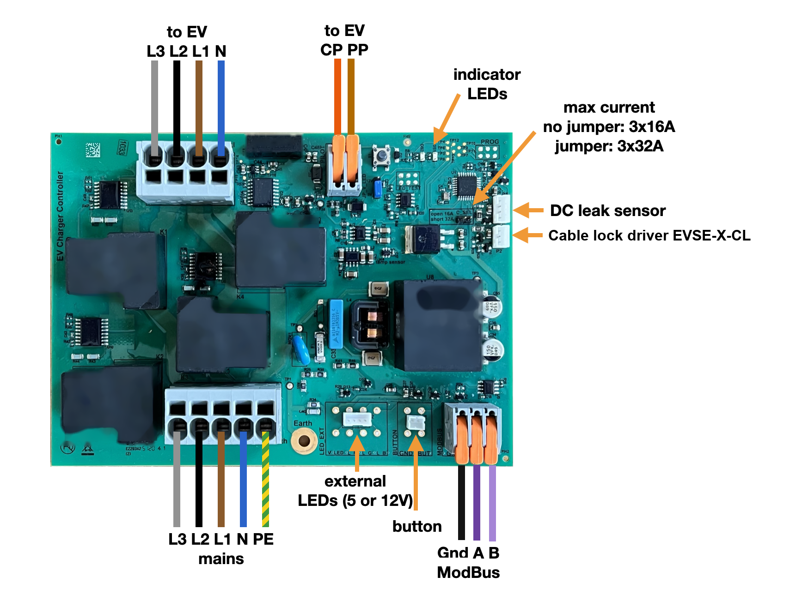

[English](../../README.md) · Nederlands

# EdgeTech-laadmodule EVSE-C-3x32A

Alles wat je nodig hebt om met de EdgeTech-laadmodule te bouwen: hoe je hem installeert, hoe je er via Modbus mee praat, en voorbeelden van wat je ermee kunt maken.

De EVSE-C-3x32A is een AC-laadmodule (Mode 3) voor één laadpunt, tot 3 × 32 A. Hij praat met de auto via de control pilot, schakelt de stroom, meet stroom en spanning per fase, beschermt tegen DC-aardlekstroom met de EVSE-X-DCD-sensor, en is een Modbus RTU-slave op RS485. Alles wat Modbus spreekt, kan hem aansturen: onze wifi-modules, evcc op een Raspberry Pi, of je eigen microcontroller.

## Snel aan de slag

1. **Installeer** de laadmodule: [installatiehandleiding](installation.md).
2. **Sluit Modbus aan**: GND, A en B met litze van 3 × 0,75 mm². 9600 baud, 8N1. De laadpaal verlaat de fabriek op adres 1, waar hij pas antwoordt na een state-verandering (druk op de knop op de print). Een EdgeTech-wifi-module zet elke nieuwe laadpaal op een eigen adres; met je eigen controller stel je een adres van 2 of hoger in (register 0x0200).
3. **Stel de stroom in**: schrijf de limiet in ampère naar register 0x0201 en lees de state uit 0x0103. Alle registers: [registeroverzicht](modbus-registers.md).

## Informatie

| Document | Waar het over gaat |
|---|---|
| [Installatie](installation.md) | Aansluitingen, draadkleuren, jumpers, leds, montagestappen, foutcodes |
| [Modbus-registeroverzicht](modbus-registers.md) | Elk register, elke state en foutcode, en een minimale regellus |
| [Load balancing](load-balancing.md) | Drie manieren: je eigen controller, evcc of een EdgeTech-wifi-module |
| [EV wake-up](ev-wake-up.md) | Auto's wekken die in slaap vallen tijdens een laadpauze (CP disconnect) |
| [NFC-kaartlezer](nfc-reader.md) | De optie EVSE-X-NFC: aansluiten, instellen en het volledige registeroverzicht |
| [Bouw je eigen laadpunt](diy-chargepoint.md) | De doe-het-zelf-kit (DHZ), stap voor stap |

## Inspiratie

[examples/](../../examples/) bevat werkende sketches voor ontwikkelborden die je kunt kopen:

| Voorbeeld | Wat het doet |
|---|---|
| [Laadpaal aansturen, basis](../../examples/charger-control-basic/) | De laadpaal uitlezen en de stroom instellen |
| [Aansturing met touchscreen](../../examples/touch-display-control/) | De laadpaal bedienen vanaf een touchscreen |
| [Slimme meter uitlezen](../../examples/smart-meter-reader/) | De P1-poort van een slimme meter (DSMR 5) uitlezen |
| [Load balancing op de slimme meter](../../examples/smart-meter-load-balancing/) | De laadstroom begrenzen tot wat het huis kan missen |
| [Laadschema op stroomprijs](../../examples/electricity-price-schedule/) | Uurprijzen ophalen om te laden als stroom goedkoop is |
| [NFC-kaartlezer](../../examples/nfc-reader/) | Kaart-ID's uitlezen van de EVSE-X-NFC (Arduino en Python) |

[tools/modbus-tool](../../tools/modbus-tool/) is een Python-tool om de laadmodule vanaf een pc te testen.

## Hardware

- [hardware/fit](../../hardware/fit/): STEP-modellen en tekeningen om de elektronica in je behuizing in te bouwen.
- [hardware/brackets](../../hardware/brackets/): 3D-printbare montagebeugels.

## Firmware

De firmware-flasher hangt bij de [releases](https://github.com/edge-tech-eu/SmartEVSE/releases) van deze repository. Hij werkt de laadmodule bij via Modbus.

## Talen

Engels is de hoofdtaal: elk document staat in het Engels in [docs/en](../en/). Nederlandse vertalingen komen in [docs/nl](./) met dezelfde bestandsnamen. Code, commentaar en bestandsnamen zijn altijd Engels.

## Licentie

Open source, in twee delen:

- **Code** (`examples/`, `tools/`): [MIT](../../LICENSE).
- **Documentatie, afbeeldingen en hardwarebestanden** (`docs/`, `images/`, `hardware/`): [CC BY 4.0](../../LICENSE-docs.md).

Uitzonderingen: bestanden met een eigen licentiekop houden die (de LilyGo-driverbestanden in de T-Panel-voorbeelden
zijn GPL-3.0). De firmware van de laadmodule en de firmware-flasher in de releases zijn geen open source.

## Veiligheid

De voorbeelden praten alleen Modbus op laagspanning. Werk aan de netspanning en in de meterkast is voor een erkend installateur.

## Contact

[support@edgetech.eu](mailto:support@edgetech.eu) · [edgetech.eu](https://edgetech.eu)
