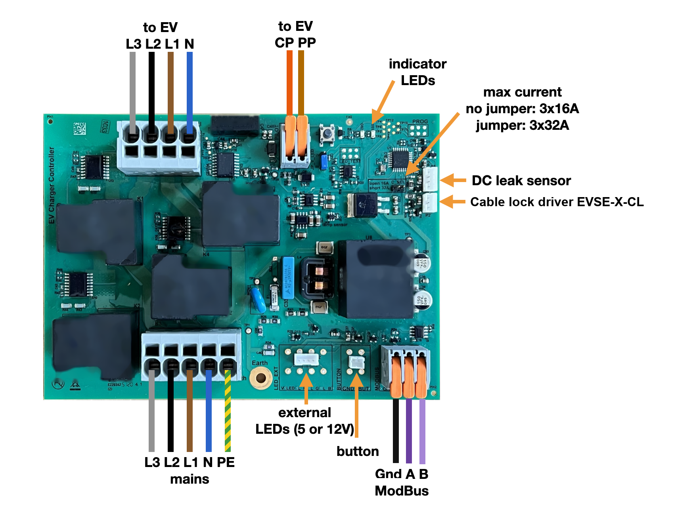
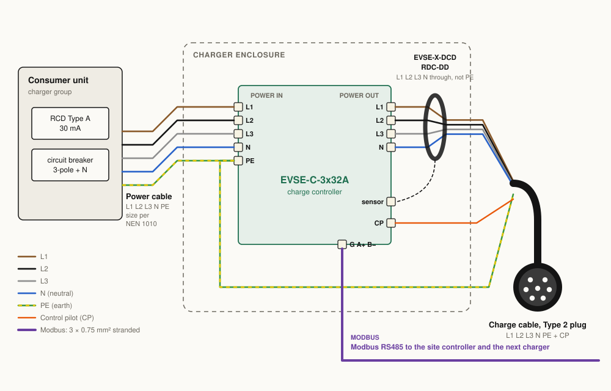
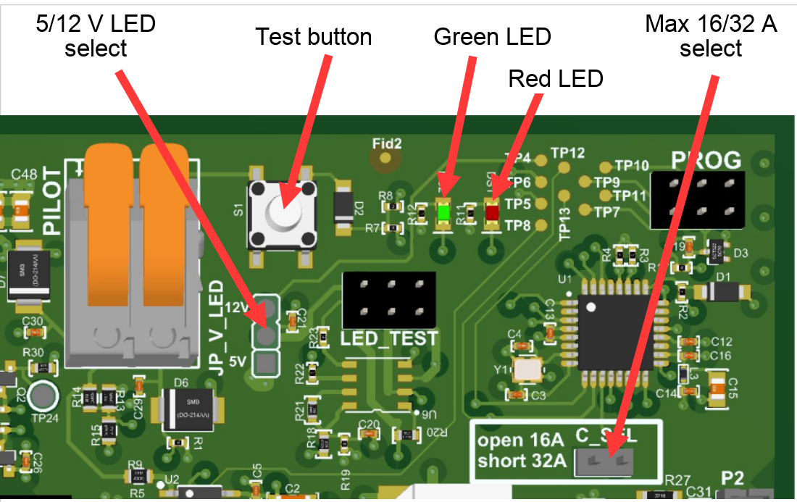
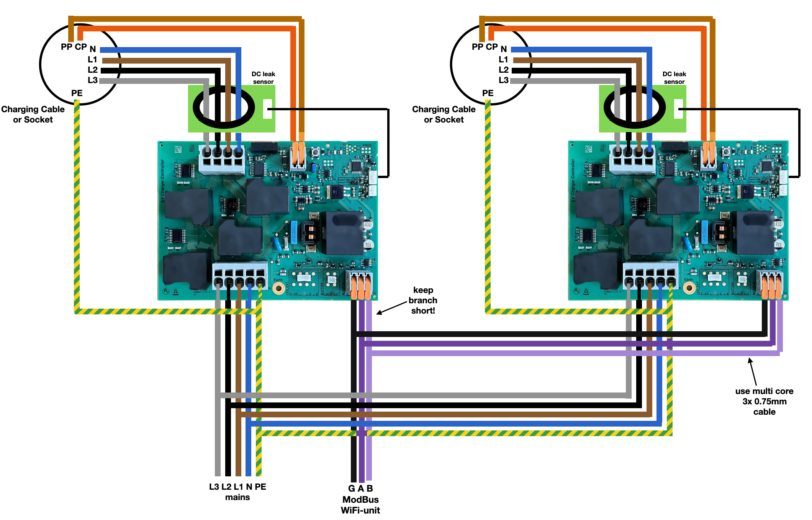

[English](../en/installation.md) · Nederlands

# De laadmodule EVSE-C-3x32A installeren

> [!IMPORTANT]
> Deze handleiding is bedoeld voor ervaren hobbyïsten en installateurs: mensen die weten hoe je een apparaat veilig op een 3-fase-voeding aansluit, wat een aardlekschakelaar is en hoe grote verbruikers in de meterkast worden aangesloten. We raden altijd aan om werk in de meterkast door een erkend installateur te laten uitvoeren.

## Aansluitingen

| Aansluiting | Waar | Wat |
|---|---|---|
| Voeding in | Grijze 5-polige printklem | L1, L2, L3, N, PE. Aderkleuren: L1 bruin, L2 zwart, L3 grijs, N blauw, PE groen-geel |
| Naar de auto | Grijze 4-polige printklem | L1, L2, L3, N van de laadkabel of contactdoos. PE van de kabel gaat naar de PE van de voeding, niet via deze printklem |
| Control pilot | 2-polige printklem met oranje hendels | CP: de dunne signaaldraad van de laadkabel of contactdoos. PP: alleen bij een type 2-contactdoos; bij een vaste kabel blijft PP leeg |
| Modbus | 3-polige printklem met oranje hendels | GND, A, B. Gebruik 3 × 0,75 mm² litze en houd aftakkingen kort |
| RDC-DD | Bovenste witte connector rechts | De DC-aardlekdetector (RDC-DD) EVSE-X-DCD, meegeleverd bij elke laadmodule |
| Kabelvergrendeling | Onderste witte connector rechts | De kabelvergrendelingsmodule EVSE-X-CL, voor laadpalen met een type 2-contactdoos |
| Externe led | LED EXT, 4-pins | RGB-led met gemeenschappelijke kathode of 3 losse leds, 5 V of 12 V (zie hieronder) |
| Knop | BUTTON, 2-pins | Externe drukknop (GND, BUT) |

De DC-aardlekdetector: voer L1, L2, L3 en N door de ring. Voer PE er **niet** doorheen.

Dezelfde bedrading als schema:

## Jumpers, leds en testknop

| Onderdeel | Instelling |
|---|---|
| C_SEL (maximale stroom) | Open: 3 × 16 A. Jumper geplaatst: 3 × 32 A |
| JP_V_LED | Spanning voor de externe led: 5 V of 12 V |
| Testknop | Geeft de print een state-verandering. Op fabrieksadres 1 antwoordt de print pas na een state-verandering |
| Groene led | Knippert elke 3 seconden als de print gevoed is en in orde is |
| Rode led | Foutcode, zie [Statuscodes en foutcodes](#statuscodes-en-foutcodes) |

### Externe led

- **LED EXT** (4-pins, 2,0 mm steek): VLED, R, G, B. Sluit een RGB-led met gemeenschappelijke kathode aan, of 3 losse leds.
- **JP_V_LED** (3-pins header met jumper) kiest VLED: 5 V of 12 V.
- **LED TEST** (2 × 3-header, 0,1" steek, solderen): dezelfde signalen als LED EXT, plus een digitale uitgang voor adresseerbare leds. Pin 1 VLED, pin 2 R, pin 3 Dout, pin 4 G, pin 5 GND, pin 6 B. Gebruik een externe voeding voor meer dan één adresseerbare led.

## Montagestappen

1. **Kies de plaats voor het laadpunt.** Leg altijd een Modbuskabel (3 × 0,75 mm² litze) naast de voedingskabel, ook als je begint zonder load balancing.
2. **Bereid de behuizing voor.** Boor met een stappenboor de gaten voor de wartels van de voedingskabel en de laadkabel. Boor de gaten in de achterwand voor montage op een muur of paal, en dicht de schroefgaten af, bijvoorbeeld met een rubberring.
3. **Monteer de laadmodule** in de behuizing, direct of met de [montagebeugels](../../hardware/brackets/).
4. **Sluit de DC-aardlekdetector aan** op de laadmodule met de meegeleverde kabel.
5. **Aarde.** Sluit de meegeleverde groen-gele draad aan op PE van de 5-polige printklem, en het andere eind op de meegeleverde insteekconnector. Alle aardedraden komen samen in die connector.
6. **Laadkabel.** Voer hem door zijn wartel.
   - Voer L1, L2, L3 en N door de ring van de DC-aardlekdetector en in de 4-polige printklem. Let op de kleuren. Om een klem te openen, druk je een platte schroevendraaier in het rechthoekige gat ernaast.
   - Sluit PE van de laadkabel aan op de insteekconnector voor de aarde.
   - Steek de dunne signaaldraad (CP) in de ingang **CP** van de 2-polige printklem met de oranje hendels, zoals op de afbeelding. Laat bij een vaste kabel **PP** leeg: PP wordt alleen gebruikt bij een type 2-contactdoos, waar de laadpaal er de stroomwaarde van de kabel uit leest. Zet de hendel helemaal omhoog, steek de draad er diep in, sluit de hendel en trek zachtjes om te controleren.
7. **Voedingskabel.** Monteer de behuizing op de muur of paal en voer de voedingskabel door zijn wartel.
   - Sluit L1, L2, L3 en N aan op de 5-polige printklem. Let op de kleuren.
   - Sluit PE aan op de insteekconnector voor de aarde.
   - Controleer dat er geen draadjes uit de printklemmen steken. Losse draadjes van litze kunnen de naastgelegen klem raken en kortsluiting veroorzaken.
8. **Modbus** (nu optioneel, nodig voor load balancing): GND, A en B op de 3-polige printklem.
9. **Schakel** de aardlekschakelaar en de installatieautomaat in de meterkast **in**. De groene led knippert elke 3 seconden.

> [!IMPORTANT]
> Als de rode led knippert, controleer dan of de aarde goed is aangesloten, zowel op de laadmodule als op de aarde van het huis.

### Twee of meer laadpalen

Laadpalen delen één Modbuslijn. Elke laadpaal verlaat de fabriek met adres 1; geef elke laadpaal een eigen Modbusadres (een EdgeTech-wifi-module doet dat voor je), houd de aftakkingen van de lijn naar elke print kort en gebruik één kabel van 3 × 0,75 mm² voor GND, A en B.

## Testen door een auto te laden

Steek de laadkabel in de auto. Laadt de auto, dan ben je klaar. Laadt hij niet, kijk dan naar de rode led op de laadmodule: aan het knipperpatroon zie je wat de fout is.

## Statuscodes en foutcodes

| Toestand (foutbyte) | Rode led |
|---|---|
| Fout bij opstarten (00000001) | Heel lang uit, heel kort aan |
| Temperatuur hoog (10010000) | Kort aan, kort uit, kort aan, lang uit |
| Temperatuur te hoog, laden gestopt (10011000) | Kort aan, kort uit, 2× kort aan, lang uit |
| Geen aarde aangesloten (10011100) | Kort aan, kort uit, 3× kort aan, even uit |
| Relais blijft ingeschakeld (10011110) | Kort aan, kort uit, 4× kort aan, kort uit |
| DC-aardfout (10010110) | Kort aan, kort uit, kort aan, kort uit, 2× kort aan, kort uit |
| OK | Uit |

Dezelfde fouten kun je via Modbus uitlezen: zie de foutbits in het [registeroverzicht](modbus-registers.md).

## Verder

- [Load balancing](load-balancing.md): begrens de laadstroom tot wat het huis kan missen.
- [EV wake-up](ev-wake-up.md): voor auto's die in slaap vallen tijdens een laadpauze.
