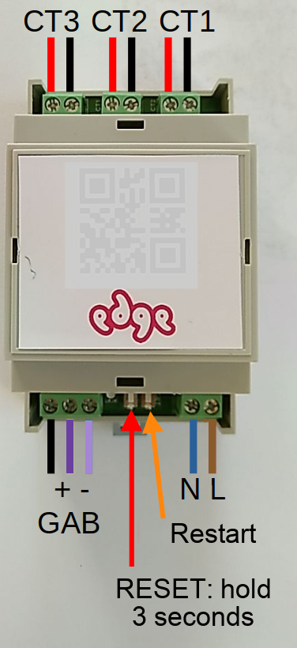
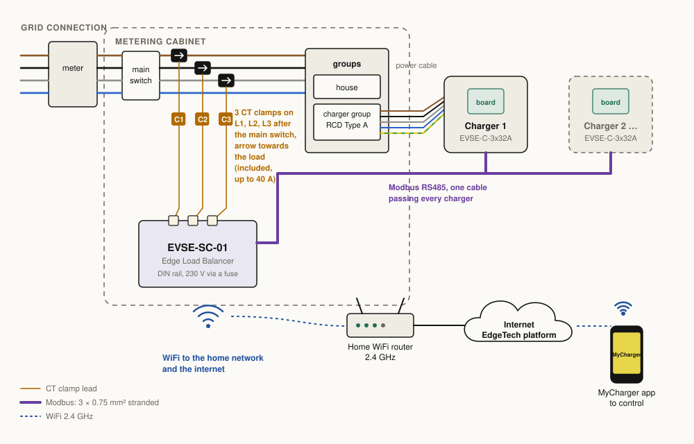
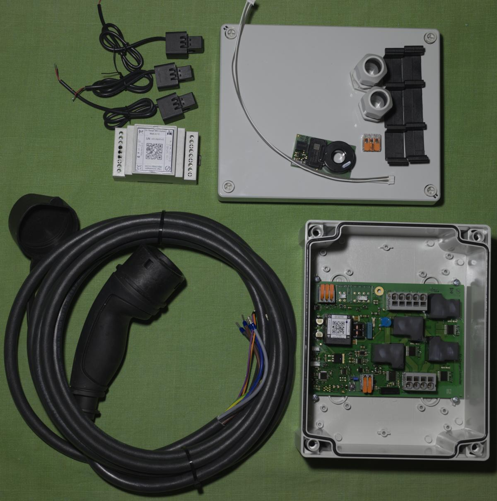
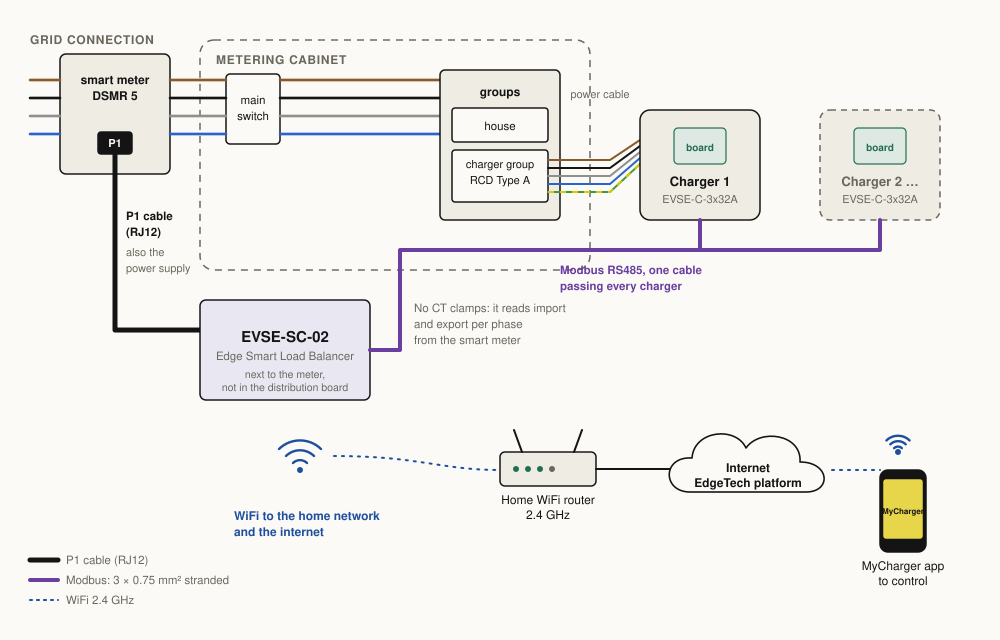
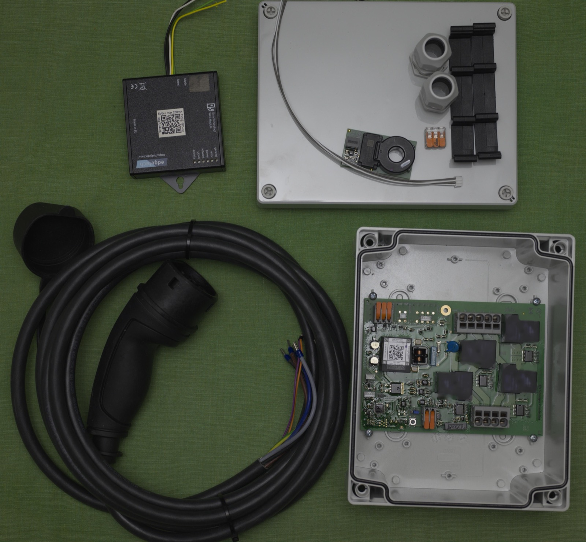

[English](../en/load-balancing.md) · Nederlands

# Load balancing

Load balancing beschermt je aansluiting tegen overbelasting. Trekt het huis te lang meer stroom dan de hoofdzekering toestaat, dan brandt de zekering door of schakelt ze af; een ouderwetse hoofdzekering moet de netbeheerder vervangen, en dat kost geld en tijd. Misschien wil je ook laden als energie goedkoop is of als het net rustig is. Load balancing betekent dat iets het huis meet en de laadmodule via Modbus vertelt hoeveel stroom die mag gebruiken.

Er zijn drie manieren om dat te doen:

| | Voor wie | Wat meet het huis | Wat stuurt de laadpaal aan |
|---|---|---|---|
| [A. Je eigen controller](#a-je-eigen-controller) | Mensen die microcontrollers programmeren | Je controller, bijvoorbeeld op de P1-poort van de slimme meter | Je eigen code, via Modbus |
| [B. Raspberry Pi met evcc](#b-raspberry-pi-met-evcc) | Mensen die thuis zijn op een Linux-commandline | De slimme meter, via een P1-kabel | evcc, via Modbus |
| [C. EdgeTech-wifi-module](#c-edgetech-wifi-module) | Iedereen die het kant-en-klaar wil | Stroomklemmen (EVSE-SC-01) of de P1-poort (EVSE-SC-02) | De wifi-module, met de MyCharger-app |

Alle drie praten met de laadmodule over dezelfde Modbuslijn: litze van 3 × 0,75 mm² naar GND, A en B. Zie [installatie](installation.md#aansluitingen) en het [registeroverzicht](modbus-registers.md). Voor je eigen code zijn twee registers van belang: de stroomlimiet (0x0201) en de state (0x0103).

## A. Je eigen controller

Voor mensen met programmeerervaring op een microcontrollerplatform. Kies een ontwikkelbord dat een RS485-interface heeft of daarmee kan worden uitgebreid. De [voorbeelden](../../examples/) laten werkende sketches zien voor verschillende borden, van alleen de laadpaal uitlezen tot volledige load balancing op de slimme meter:

- [Laadpaal aansturen, basis](../../examples/charger-control-basic/): de laadpaal uitlezen en de stroom instellen.
- [Slimme meter uitlezen](../../examples/smart-meter-reader/): de P1-poort van een Nederlandse slimme meter (DSMR 5) uitlezen.
- [Load balancing op de slimme meter](../../examples/smart-meter-load-balancing/): beide samen, met een display.

## B. Raspberry Pi met evcc

Voor mensen die al eens met een Linux-systeem en een terminal hebben gewerkt. Een Raspberry Pi (bijvoorbeeld een 3B) met een P1-kabel naar de slimme meter en een RS485-interfacebord draait [evcc](https://evcc.io), een opensource-laadmanager.

1. Schrijf de SD-kaart met de Raspberry Pi Imager. Kies een hostnaam die je terug kunt vinden (bijvoorbeeld `loadbalancer`). Vul op een Pi zonder ethernet ook de wifigegevens in, zodat je de Pi altijd met ssh kunt bereiken.
2. Sluit de Pi aan op je netwerk en log in met ssh.
3. Installeer evcc: volg <https://docs.evcc.io/en/docs/installation>.
4. Zet de laadmodule eerst op Modbusadres 2 of hoger (register 0x0200); op adres 1 antwoordt hij pas na een state-verandering.
5. Voeg de laadpaal toe aan `evcc.yaml`. Het voorbeeld hieronder is voor een RS485-bord op de seriële poort van de Pi, adres 2, 9600 baud 8N1:

```yaml
chargers:
- type: template
  template: smartevse
  id: 2
  device: /dev/ttyS0
  baudrate: 9600
  comset: 8N1
  modbus: rs485serial
  name: charging point 1
```

6. Maak met een P1-kabel de slimme meter beschikbaar op een netwerksocket met `ser2net`, en voeg hem toe als netmeter:

```yaml
# evcc.yaml
meters:
- type: template
  template: dsmr
  usage: grid
  host: 127.0.0.1   # ser2net
  port: 2000
  name: grid
```

```yaml
# ser2net.yaml
%YAML 1.1
---
connection: &conDSMR
    accepter: tcp,2000
    enable: on
    options:
      max-connections: 3
      kickolduser: true
    connector: serialdev,
              /dev/ttyUSB0,
              115200n81,local
```

7. Voeg loadmanagement toe: volg <https://docs.evcc.io/en/docs/features/loadmanagement>.

## C. EdgeTech-wifi-module

Voor mensen die alles zelf willen installeren, maar de aansturing niet willen programmeren. De wifi-module zit op de Modbuslijn, meet het huis, begrenst de laadstroom en maakt verbinding met je wifi thuis, zodat je het laden kunt bedienen met de MyCharger-app. Load balancing blijft ook werken zonder MyCharger-abonnement; je verliest dan de bediening vanuit de app.

### EVSE-SC-01 met stroomklemmen

Voor huizen zonder slimme meter van het type DSMR 5. De SC-01 komt op een DIN-rail in de meterkast. Plaats de drie stroomklemmen om L1, L2 en L3 tussen de meter en de hoofdschakelaar, waar de drie fasen nog niet over de groepen zijn verdeeld.







### EVSE-SC-02 op de P1-poort

Voor huizen met een slimme meter van het type DSMR 5. De SC-02 wordt met een RJ12-kabel op de P1-poort aangesloten en haalt daar ook zijn voeding uit, dus er komt niets in de meterkast en er zijn geen stroomklemmen nodig. Op de Modbuslijn werkt hij op 19200 baud.




