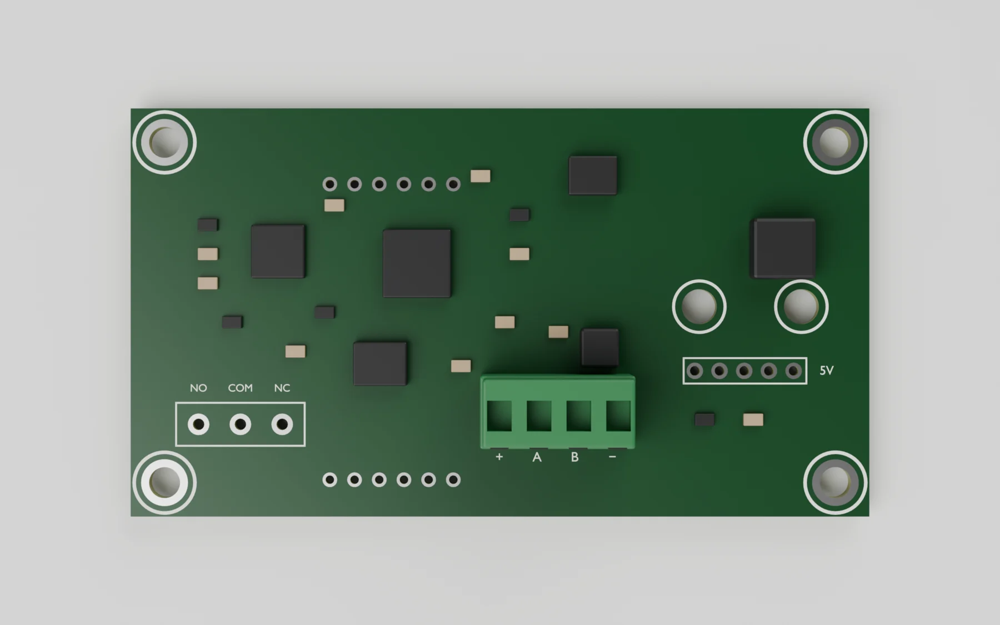
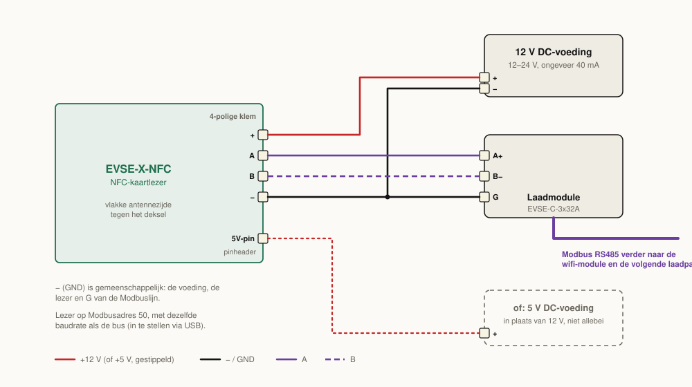

[English](../en/nfc-reader.md) · Nederlands

# NFC-kaartlezer EVSE-X-NFC

De EVSE-X-NFC is een optionele kaartlezer voor de laadpaal. Hij zit in de behuizing, met de vlakke antennezijde tegen het kunststof deksel, en leest kaarten door het deksel heen. Hij is een Modbus RTU-slave op dezelfde RS485-lijn als de laadmodule. De master (een EdgeTech-wifi-module of je eigen controller) vraagt ongeveer elke seconde of er een kaart is gelezen en krijgt het kaart-ID terug.

De print is de Modbus-MIFARE-lezer van Inveo (Polen), "RFID IND Modbus Mif", als losse print, door ons ingesteld voor de laadpaal. De handleiding en het configuratieprogramma van de fabrikant staan op [inveo.com.pl](https://inveo.com.pl/software).

## Specificaties

| | |
|---|---|
| Kaarten | MIFARE-kaarten, ISO/IEC 14443-A (NFC-A), 13,56 MHz; herkend aan de UID (4, 7 of 10 bytes). Nederlandse laadpassen zijn zulke kaarten |
| Leesafstand | Tot ongeveer 10 cm in vrije lucht, afhankelijk van de kaart; minder door het deksel heen |
| Voeding | 12 V DC op + en − van de 4-polige klem (12–24 V, ongeveer 40 mA bij 12 V), **of** 5 V DC op de 5V-pin van de pinheader. Niet allebei |
| Modbus | RTU op RS485, A en B op de 4-polige klem, GND op −. EdgeTech-lezers staan op adres 50 |
| Print | 76 × 42 mm, 12 mm hoog, 4 × Ø3,2 mm hoekgaten. Houd 25 mm vrij voor de klem voor de draden |
| Instellen | Via USB, met het configuratieprogramma van de fabrikant (een klein USB-printje op de 5-polige pinheader) |

## Aansluiten

| Lezer | Gaat naar |
|---|---|
| + | +12 V DC van een voeding in de laadpaal |
| A | A (A+) van de Modbuslijn, zoals op de laadmodule |
| B | B (B−) van de Modbuslijn |
| − | GND: de − van de voeding en G van de Modbuslijn |
| 5V-pin (pinheader) | Alleen als je de lezer met 5 V DC voedt in plaats van 12 V. Laat + dan los |

Gebruik dezelfde kabel van 3 × 0,75 mm² litze als voor de rest van de Modbuslijn, plus één draad voor de voeding.

## Instellen

Alleen nodig als je het Modbusadres of de baudrate wijzigt.

1. Download de "RFID M1/U1 Configurator" van [inveo.com.pl/software](https://inveo.com.pl/software).
2. Zet het USB-printje op de 5-polige pinheader en sluit het aan op de pc. De lezer krijgt dan voeding via USB.
3. Stel **Device Address** in (wij gebruiken 50), **BaudRate** (gelijk aan de bus: 9600 met je eigen controller, 19200 met een EVSE-SC-02) en **Mode** (pariteit: None).
4. Sla op en herstart de lezer (spanning eraf en erop).
5. Sluit het configuratieprogramma: zolang het verbonden is, werkt Modbus niet.

## Een kaart lezen

Elke seconde:

1. Lees holding register **999** (IsNewTag). 1 betekent dat er een nieuwe kaart is gelezen.
2. Is het 1: lees register **1000** (lengte van de UID in bytes) en **1001** en verder (de UID, één byte per register). Stap 1 en 2 passen in één verzoek: 12 registers vanaf 999.
3. Wis de vlag: schrijf 0 naar coil **1015**. Pas dan leest de lezer de volgende kaart.

Werkende voorbeelden:

- [examples/nfc-reader/Raspberry_Pico2W_2CH_RS485](../../examples/nfc-reader/Raspberry_Pico2W_2CH_RS485/): Arduino-sketch voor een Raspberry Pi Pico 2 W met de Waveshare RS485-module met 2 kanalen.
- [examples/nfc-reader/python](../../examples/nfc-reader/python/): Python 3 met pymodbus, voor een pc of Raspberry Pi met een USB-RS485-adapter.

## Registeroverzicht

**Nummering.** De handleiding van de fabrikant nummert registers en coils vanaf 1. Op de lijn (en in de meeste Modbus-bibliotheken) beginnen ze bij 0, dus trek er 1 af: holding register 1000 uit de handleiding is adres 999, coil 1016 is adres 1015. De tabellen geven beide. De firmware van onze wifi-modules gebruikt de adressen vanaf 0.

Ondersteunde functies: 0x01 coils lezen, 0x03 holding registers lezen, 0x05 één coil schrijven, 0x06 één register schrijven, 0x0F meerdere coils schrijven, 0x10 meerdere registers schrijven.

### Holding registers

| Adres (vanaf 0) | Handleiding | L/S | Betekenis |
|---|---|---|---|
| 999 | 1000 | L/S | IsNewTag: 1 = kaart gelezen, 0 = geen. Wis (0) voordat de volgende kaart wordt gelezen. Gelijk aan coil 1015 |
| 1000 | 1001 | L | Lengte van de UID in bytes: 4, 7 of 10 |
| 1001–1010 | 1002–1011 | L | UID, één byte per register |
| 1011 | 1012 | L | Kaarttype |
| 1016 | 1017 | L | Model-ID |
| 1017 | 1018 | L | Softwareversie |
| 1018 | 1019 | L | Hardwareversie |
| 1019 | 1020 | L/S | Werking relaisuitgang 1: 1 bistabiel, 2 astabiel, 3 tijd |
| 1020 | 1021 | L/S | Uitgang 1 tijd aan, in 0,1 s (1–65535) |
| 1021 | 1022 | L/S | Uitgang 1 tijd uit, in 0,1 s |
| 1022–1024 | 1023–1025 | L/S | Uitgang 2: werking, tijd aan, tijd uit |
| 1999 | 2000 | L/S | WriteEnable: schrijven naar de volgende kaart |
| 2000 | 2001 | L/S | ReadEnable: gegevens lezen van de volgende kaart |
| 2001 | 2002 | L/S | Kaarttype voor gegevens: MIFARE 1k (0) of 4k (1) |
| 2002 | 2003 | L/S | Geheugenmodus: lineair (0) of volledig (1) |
| 2003 | 2004 | L/S | Datamodus (0–2): hoe bytes in de buffers staan |
| 2004 | 2005 | L/S | Signalering bij elke gelezen kaart (leds, zoemer goed/fout) |
| 2005 | 2006 | L/S | Signalering na het lezen van gegevens (goed / fout) |
| 2006 | 2007 | L/S | Signalering na het schrijven van gegevens (goed / fout) |
| 2007 | 2008 | L/S | HaltTag: 1 = stop met deze kaart en wacht op de volgende |
| 2008 | 2009 | L/S | WakeAll: 1 = antenne kort uit, zodat alle kaarten resetten |
| 2009 | 2010 | L/S | Resultaat laatste keer lezen: 0 goed, 1 fout |
| 2010 | 2011 | L/S | Resultaat laatste keer schrijven: 0 goed, 1 fout |
| 2019–2034 | 2020–2035 | L/S | Te lezen blokken, één bit per blok |
| 2039–2054 | 2040–2055 | L/S | Te schrijven blokken, één bit per blok |
| 2099–2354 | 2100–2355 | L/S | Leesautorisatie per blok: sleutel A of B, opgeslagen sleutel 0–7 |
| 2399–2654 | 2400–2655 | L/S | Schrijfautorisatie per blok |
| 2699–2954 | 2700–2955 | L/S | Leesresultaat per blok (0 = goed) |
| 2999–3254 | 3000–3255 | L/S | Schrijfresultaat per blok (0 = goed) |
| 3999–8094 | 4000–8095 | L/S | Leesbuffer (kaartgegevens) |
| 9999–14094 | 10000–14095 | L/S | Schrijfbuffer (kaartgegevens) |

### Coils

| Adres (vanaf 0) | Handleiding | L/S | Betekenis |
|---|---|---|---|
| 999 | 1000 | L/S | Relaisuitgang 1 aan/uit |
| 1000 | 1001 | L/S | Relaisuitgang 2 aan/uit |
| 1001 | 1002 | L | Stand relais 1 |
| 1002 | 1003 | L | Stand relais 2 |
| 1009 | 1010 | L | Ingang 1 |
| 1010 | 1011 | L | Ingang 2 |
| 1011 | 1012 | L/S | Led 1 (rood) |
| 1012 | 1013 | L/S | Led 2 (groen) |
| 1013 | 1014 | S | Zoemer: geluid goed |
| 1014 | 1015 | S | Zoemer: geluid fout |
| 1015 | 1016 | L/S | IsNewTag (gelijk aan holding register 999). Schrijf 0 om de volgende kaart te lezen |
| 1016 | 1017 | L/S | ResetFlag: 1 na inschakelen; wis hem om een herstart te kunnen zien |

Relais en ingangen: de relaisklem (NC, COM, NO) is niet geplaatst op de EdgeTech-versie, dus de registers voor relais en ingangen doen daar niets.

Instellingen die je via Modbus schrijft (uitgangen, signalering) worden niet opgeslagen: na een herstart gaat de lezer terug naar wat het configuratieprogramma heeft opgeslagen.

## Opmerkingen

- **Continuous Read Mode** (in het configuratieprogramma): staat die aan, dan zet de lezer IsNewTag niet. Laat hem uit als je uitleest zoals hierboven.
- **Eén lezer per lijn.** Meestal is er één lezer per Modbuslijn, ook bij meer laadpalen: de timing bepaalt bij welke laadpaal een kaart hoort. Alle lezers antwoorden op adres 50, dus een tweede lezer op dezelfde lijn heeft een ander adres nodig.
- **Whitelist.** De lezer meldt alleen het kaart-ID. Wie mag laden, beslist de master: een EdgeTech-wifi-module (whitelist in de MyCharger-app) of je eigen code.
- **De firmware van de EdgeTech-wifi-module** leest tot 7 bytes van de UID. Kaarten met een UID van 4 of 7 bytes (bijna alle) werken.

## Licentie

Dit document: [CC BY 4.0](../../LICENSE-docs.md). Voorbeeldcode: [MIT](../../LICENSE). Registergegevens uit de handleiding van de fabrikant "RFID IND Modbus Mif" (software 1.40 en later).
