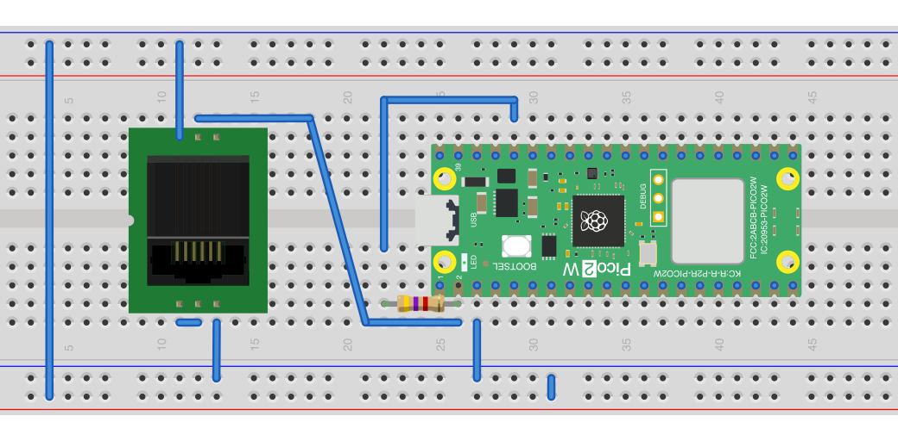

# Smart meter reader

Read a Dutch DSMR 5 smart meter through its P1 port and print the current per phase. This is the input you need to load-balance the charge controller (EVSE-C-3x32A).

## What it does

- Opens the P1 port on UART0 (`Serial1`) at 115200 baud with the RX input inverted (`Serial1.setInvertRX(true)`) and a 1024-byte receive buffer (`setFIFOSize()`). The P1 signal is inverted, and the RP2040/RP2350 can invert it in hardware, so you only need an RJ12 cable.
- Waits up to 2 s for a telegram, reads it to the end and checks it is DSMR 5.0 (line `1-3:0.2.8(50)`); it also notes whether the meter is single phase (no `1-0:72.7.0` line). This is the same check as in the [smart-meter-load-balancing](../smart-meter-load-balancing/) example. If the check fails, it prints "No compatible meter found!" with a code (1 = no data, 3 = no complete telegram, 4 = not DSMR 5.0) and stops.
- Then, for every telegram, reads voltage per phase (`1-0:32.7.0`, `52.7.0`, `72.7.0`) and power imported (`21.7.0`, `41.7.0`, `61.7.0`) and exported (`22.7.0`, `42.7.0`, `62.7.0`) per phase.
- Computes the current per phase as `1000 × (import kW − export kW) / V` and prints it on the serial monitor (115200 baud):

  ```
  Current: 1.234000, 0.456000, 2.345000
  ```

  A negative value means that phase exports power (for example from solar panels). On a single-phase meter L2 and L3 are 0.

This sketch does not talk to the charge controller. To use the result, combine it with the [charger-control-basic](../charger-control-basic/) code, or see the [smart-meter-load-balancing](../smart-meter-load-balancing/) example, which does both on one board.

## What you need

- WIZnet W55RP20-EVB-Pico (see the [board note](../boards/wiznet-w55rp20-evb-pico.md)). Any RP2040 or RP2350 Pico board should work; the wiring diagram shows a Raspberry Pi Pico 2 W.
- A DSMR 5 smart meter with a P1 port.
- An RJ12 (6P6C) cable and a breadboard or RJ12 socket.
- No RS485 interface or charger cable: this example only reads the meter.

## Wiring



The Fritzing source is [wiring-p1-pico.fzz](wiring-p1-pico.fzz).

P1 pinout (RJ12 6P6C): 1 = +5 V, 2 = data request, 3 = data ground, 4 = not connected, 5 = data, 6 = power ground.

| Pico pin | P1 (RJ12) pin | Notes |
|---|---|---|
| GP1 (UART0 RX, physical pin 2) | 5 (data) | RX is inverted in software |
| GND | 3 (data ground) and 6 (power ground) | |
| — | 2 (data request) | Must be pulled to +5 V so the meter sends data |

GP0 (UART0 TX) is not used. The code does not enable a pull-up on the data line. The meter's data output is open collector: if your wiring has no pull-up, add a 4.7 kΩ resistor from the data line to **3.3 V** (the Pico's 3V3 pin), as in the M5Stack load-balancing example. Never pull the data line up to 5 V: the Pico pins are 3.3 V. Only the data request line (P1 pin 2) goes to +5 V; it is an input of the meter. Which 5 V source to use for the data request is to be confirmed from the diagram.

## Build and upload

- Arduino IDE 2.x (or `arduino-cli`).
- Board package: "Raspberry Pi Pico/RP2040/RP2350" (arduino-pico, by Earle Philhower). Select your board, for example "WIZnet W55RP20-EVB-Pico" or "Raspberry Pi Pico 2W".
- No extra libraries. `W55RP20lwIP.h` comes with the arduino-pico core; the sketch includes it but does not use Ethernet. On a board without the W55RP20, remove that `#include`.
- The sketch waits 10 s after start-up so you can open the serial monitor.

## Configure

| Setting | Where | Default | Notes |
|---|---|---|---|
| P1 UART | `DSMR5Reader.cpp`, `dsmr5reader_init()` | `Serial1` (UART0), RX = GP1, 115200 baud, RX inverted | |
| Check timeout | `DSMR5Reader.cpp`, `dsmr5reader_check()` | 2000 ms | |
| Line buffer | `DSMR5Reader.cpp`, `LINE_BUFFER_SIZE` | 256 | |

There is no Modbus address to set: this sketch does not talk to the charge controller.

## How it talks to the charge controller

It doesn't. To act on the measured current, write the charge current to register 0x0201 of the charge controller, as the [smart-meter-load-balancing](../smart-meter-load-balancing/) example does. See the [Modbus register map](../../docs/en/modbus-registers.md).
