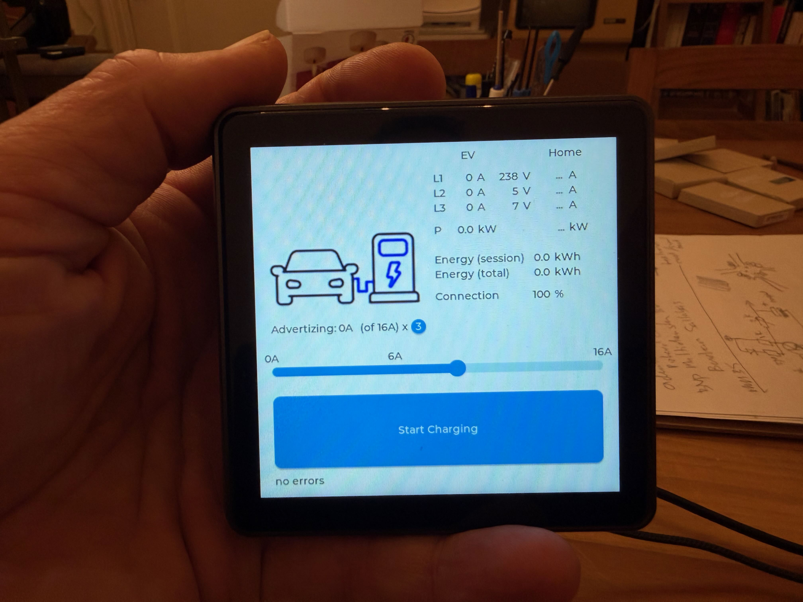

# Touch display control

Show the state of the charge controller (EVSE-C-3x32A) on a touch screen, with a slider for the charge current and a 1/3-phase button.

More photos: [2](images/lilygo_tpanel_example_2.jpeg), [3](images/lilygo_tpanel_example_3.jpeg). Video: [lilygo_tpanel_example.mov](images/lilygo_tpanel_example.mov).

## What it does

- At start-up it reads option register 0x010C to find out whether the board is a 16 A or 32 A version, and sets the slider range to 0–16 A or 0–32 A.
- It reads the serial number, firmware version and cable/advertised current, and prints them on the serial monitor (115200 baud).
- Every second it reads the charger state and shows on screen:
  - state (with a picture on the LilyGo: charger, EV connected, EV charging),
  - current and voltage per phase,
  - session energy and total energy,
  - Modbus connection quality in percent (LilyGo): the share of successful reads.
- The slider sets the current to advertise and writes it to register 0x0201 (`smart_evse_set_max_current()`). Values from 1 to 5 A are set back to 0 A (the minimum charge current is 6 A). On the LilyGo the current is only written while "Allow charging" is on; otherwise 0 A is written. The sketch writes the value again every second, because the charger falls back to its static limit when the writes stop.
- The button switches between 1 and 3 phases: it stops charging (0 A for 3 s), changes bit 0 of register 0x0204 with a read-modify-write (`smart_evse_set_phases()`, the other settings bits are kept) and then restores the current. 0 A keeps being written during the switch.
- Both screens have a "Home" column for house currents (`ui_set_home_values()`), but these sketches don't fill it. The smart-meter-load-balancing example does.

The writes happen in the callbacks `ui_set_advertizing_current_callback()` and `ui_set_phases_callback()` in the `.ino` files. The M5Stack sketch writes the full slider value at start-up (the slider starts at the board maximum); the LilyGo sketch starts with charging off (0 A).

## What you need

- One of the boards under [Variants](#variants):
  - LilyGo T-Panel S3, RS485 version (V1.2), 480 × 480 touch screen, RS485 built in; or
  - M5Stack CoreS3 SE with the M5Stack COMMU module (RS485), 320 × 240 touch screen.
- Cable: 3 × 0.75 mm² stranded multi-core (GND, A, B). Keep branches short.
- A USB-C cable to program the board.

## Wiring

| Board | Board terminal | Charge controller terminal |
|---|---|---|
| LilyGo T-Panel S3 | SGND | GND |
| | L | A |
| | H | B |
| M5Stack COMMU module | G (pin 4) | GND |
| | A (pin 2) | A |
| | B (pin 1) | B |

Terminal names come from the comments in the `.ino` files.

## Build and upload

Arduino IDE 2.x (or `arduino-cli`).

**LilyGo_T-Panel-S3_LCD**

- Board package: esp32 by Espressif, **version 2.x**. The sketch notes that lvgl does not compile with 3.x.
- Board "ESP32S3 Dev Module" with: USB CDC On Boot "Enabled", Flash Size 16MB, Partition Scheme "16M Flash (3MB APP/9.9MB FATFS)", PSRAM "QSPI PSRAM".
- Libraries (install with the Library Manager or from GitHub):
  - "GFX Library for Arduino" 1.4.6 (moononournation/Arduino_GFX)
  - "lvgl" 8.3.5
  - "TouchLib" 0.0.2 (mmMicky/TouchLib)
- `pin_config.h` and `XL95x5_Driver.*` are in the sketch folder. The images (`charger_200x100.c`, `ev_connected_200x100.c`, `ev_charging_200x100.c`) are compiled in; the PNG originals are in `LilyGo_T-Panel-S3_LCD/images/`.
- lvgl needs an `lv_conf.h`. Copy `lv_conf_template.h` from the lvgl library to `lv_conf.h` (next to the `lvgl` folder) and set:
  - `#if 1` at the top (enable the content),
  - `LV_TICK_CUSTOM 1` (the sketch does not call `lv_tick_inc()`),
  - `LV_MEM_CUSTOM 1`,
  - `LV_DISP_DEF_REFR_PERIOD 10`.

  These are the settings of the `lv_conf.h` that used to ship with this example. Other settings can stay at their defaults.
- Ignore the line "install the libraries in the libraries folder of this sketch" in the `.ino` header: that folder has been removed.

**M5Stack-CoreS3-SE-IOT**

- Board package: M5Stack (esp32 core by M5Stack), board "M5CoreS3". The board "M5CoreS3" in the Espressif esp32 core 3.x also works (compile-checked).
- Libraries: M5Unified, M5GFX, M5Module-Display (`M5ModuleDisplay.h`). Versions: to be confirmed.

## Configure

| Setting | Where | Default | Notes |
|---|---|---|---|
| `ADDRESS` | `.ino` | `1` | Modbus address of the charge controller. The charger leaves the factory at address 1. Address 1 is special: after boot the charger does not answer there, only after a state change (press the button on the board, or plug in a car). EdgeTech site controllers move each new charger to its own address so all chargers can be reached. For your own controller, give the charger an address of 2 or higher via register 0x0200 (and save it), then set `ADDRESS` to match. On a failed read at address 1 the sketch prints a hint. |
| Baud rate | `SmartEVSE.cpp`, `smart_evse_init()` | 9600 | 8N1. |
| `INTERVAL` | M5 `.ino` | 1000 ms | Poll interval. The LilyGo sketch also polls every 1000 ms. |
| `ALLOW_MISSING` | M5 `.ino` | 3 | Missed reads before the values on screen are cleared. |
| `PHASES` | M5 `.ino` | 3 | Initial state of the phase button. |
| Board version | LilyGo `pin_config.h` | `T_Panel_V1_2_RS485` | Select `T_Panel_V1_0_RS485` for a V1.0 board. |

## How it talks to the charge controller

The board is the Modbus master. It uses the shared functions in `SmartEVSE.cpp`:

| Register | Access | Used for |
|---|---|---|
| 0x0000 (5 registers) | read input | Serial number |
| 0x0005 | read input | Firmware version |
| 0x0102 | read input | Max cable current (low byte), advertised current (high byte) |
| 0x0102–0x010E | read input | Cable current, state and errors, temperature, current L1–L3, session energy, voltage L1–L3, options, total energy (32 bit) |
| 0x010C | read input | Bit 1: 32 A board |
| 0x0201 | write single | Max current in A from the slider (`smart_evse_set_max_current()`), every second and on every change |
| 0x0204 | read holding, then write single | Bit 0: 3 phases (`smart_evse_set_phases()`, read-modify-write) |

Full details: [Modbus register map](../../docs/en/modbus-registers.md).

## Variants

### LilyGo_T-Panel-S3_LCD

- UI built with lvgl: header with EV and Home columns, per-phase current/voltage, energy, a picture of the charger state, a current slider, an "Allow charging / Stop charging" button and a 1/3-phase button.
- RS485 on UART2: TX = GPIO16, RX = GPIO15 (V1.2). The RS485 direction pin is on the XL95x5 I/O expander (`XL95X5_RS485_CON` = 7) and is set low at start-up.
- Display: 480 × 480 RGB panel driven through the XL95x5 expander; touch controller at I2C address 0x5A on SDA = GPIO17, SCL = GPIO18, interrupt GPIO21.

### M5Stack-CoreS3-SE-IOT

- UI drawn with M5Unified: EV and Home columns, per-phase current/voltage, energy, state, a current slider and a 3/1 phase button.
- RS485 through the COMMU module on `Serial2`: RX = GPIO18, TX = GPIO17.
- Extra debug output on `Serial1` at 115200 baud: RX = GPIO2, TX = GPIO1.
- Values are cleared from the screen after `ALLOW_MISSING` failed reads in a row.
