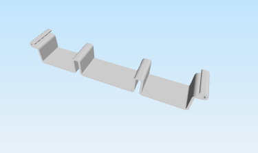

# Brackets

3D-printable brackets to mount the charge controller (EVSE-C-3x32A).

The render shows one of the brackets; which file it matches is to be confirmed.

## The brackets

| Design | Files | Size (L × W × H, from the STL) | What it is for |
|---|---|---|---|
| Bracket, parameterised C thickness (v3) | `bracket c-thickness parameterized v3.stl / .3mf / .f3d` | about 124 × 19 × 20 mm | Single bracket. The Fusion 360 file has a parameter for the thickness of the C-shaped clip, so you can fit it to your mounting surface. The parameter name and range are to be confirmed in the `.f3d`. |
| Double bracket (v3) | `double bracket v3.stl / .3mf / .f3d` | about 132 × 21 × 20 mm | Double version of the bracket. Exact use (for example two boards side by side) is to be confirmed. |
| Socket DIN-rail mount (v1) | `socket-din-rail-mount v1.stl / .3mf / .f3d` | about 127 × 20 × 15 mm | Mount for a socket on a DIN rail. Which socket it fits is to be confirmed. |
| Bracket (STEP) | `bracket.step` | — | A bracket in neutral STEP format, exported from Fusion 360 in 2021. Probably an earlier version of the single bracket (to be confirmed). |

Sizes assume the STL files are in millimetres.

## File types

| Extension | Use it for |
|---|---|
| `.stl` | Print directly: open in any slicer. |
| `.3mf` | Print directly: same model, in the 3MF format most slicers prefer. |
| `.f3d` | Edit in Autodesk Fusion 360 (change parameters, then export a new STL/3MF). |
| `.step` | Edit or import in any CAD program. |
